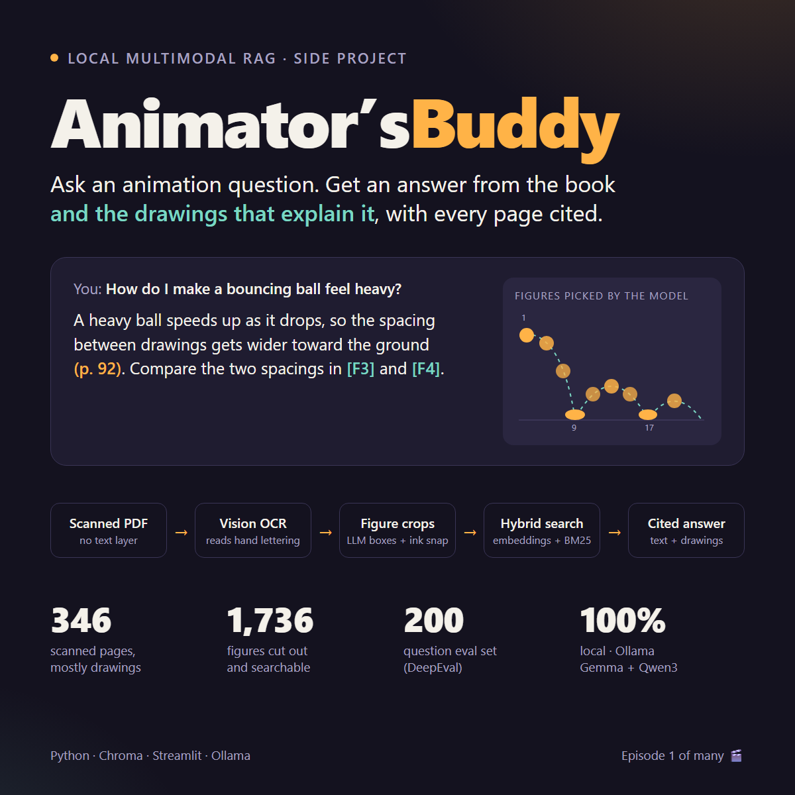
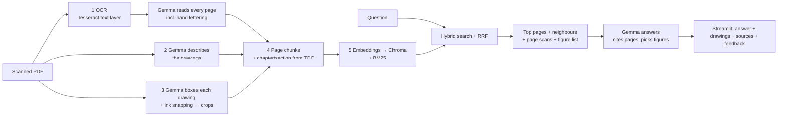

# 🎬 Animator'sBuddy

**Ask an animation question — get an answer grounded in a real animation book, with the book's own drawings as the explanation.**

Animator'sBuddy is a fully local, multimodal RAG (retrieval-augmented generation) system.
It was built and tested on Richard Williams' *The Animator's Survival Kit* — a scanned,
346-page book where most of the teaching lives in hand-drawn sequences and hand-lettered
notes, not in paragraphs. If a pipeline can handle that, it can handle almost any book.



> **This repo contains code only.** The book is copyrighted, so no PDF, page scans, OCR
> text, figures or index are included. Bring your own PDF and rebuild everything with one
> command (see [Quick start](#quick-start)).

---

## Why

Animation is learned visually. A text-only chatbot can tell you "a double bounce walk
bounces twice per step" — but an animator needs to *see* the passing position sitting low
on frame 9. Animator'sBuddy answers in words **and** points you to the exact drawings on the
exact pages, so every answer can be checked against the source.

## What it does

- 💬 **Answers with citations** — every claim cites the printed page, e.g. *(p. 118)*.
- 🖼 **Shows the drawings** — the model picks the most useful cut-out figures (`[F1]`, `[F3]`)
  and the app displays them under the answer, plus the full page scans.
- 🔎 **Hybrid search** — meaning (embeddings) + exact terms (BM25), so both
  *"how do I make a walk feel heavy?"* and *"Ken Harris"* work.
- 🧭 **Knows where it is in the book** — every chunk carries chapter › section and the
  printed page number, parsed from the book's own table of contents.
- 🙅 **Says "not in the book"** — out-of-scope questions are declined, false premises corrected.
- 📊 **Measured, not guessed** — a 200-question golden dataset and DeepEval-based evaluation.
- 👍👎 **Live feedback** — rate answers in the app and mark the correct pages; those become test cases.

Everything runs locally through [Ollama](https://ollama.com): `gemma4:26b` (vision + answers)
and `qwen3-embedding:0.6b` (search). No data leaves the machine.

---

## How it works



| Step | Command | What happens |
|---|---|---|
| 1. OCR | `python main.py ocr` | Tesseract adds a text layer; pages are then re-read by Gemma, which handles hand lettering Tesseract garbles. |
| 2. Describe | `python main.py describe` | Gemma describes what each page's drawings show (poses, timing, technique). |
| 3. Crop | `python main.py crop` | Gemma returns a rough box + label per drawing; boxes are snapped to the actual ink and saved as figures. |
| 4. Chunk | `python main.py chunk` | One chunk per page (long pages split with overlap), with chapter › section header and drawing description. |
| 5. Index | `python main.py index` | Chunks embedded with Qwen3-Embedding and stored in Chroma; BM25 built at query time. |
| Ask | `python main.py ask "…"` / `python main.py ui` | Retrieve → expand neighbouring pages → Gemma answers with page scans attached. |

---

## The hard parts (edge cases we handled)

**Document handling — a scanned book is not a PDF of text**
- The PDF had **no text layer at all** (346 image-only pages). Detected automatically, OCR'd with OCRmyPDF.
- Tesseract read printed text fine but turned hand lettering into noise (*"HEAD CONTINUES FORWARD"* → *"PESITIO NUES FORWARP"*). A "hard page" heuristic (length + share of real words) was not enough — so every page is re-read by a vision LLM, keeping the Tesseract text for comparison.
- **Runaway generation:** on pages full of frame numbers or `+` registration marks, the model looped (*"1/2 3/2 1/2…"*) for 28k tokens and blocked the GPU queue. Fixed with a token cap, a smaller context window, a prompt rule to ignore registration marks, and loop-trimming that only triggers when the cap is hit — so pages that *genuinely* repeat a label (*"BDWN" ×11*) stay intact.
- Ghostscript unavailable on Windows → rasterize with pypdfium2 instead.
- Every long step is **resumable**: results are saved per page, so a crash or reboot loses nothing.

**Structure — making chunks know where they are**
- Chapter/section parsed from the book's own table of contents — after fixing a bug where hand-lettered numbered lists ("1 LEAN the BODY") were mistaken for TOC entries.
- **Printed vs PDF page numbers** drift (offset 7 → 6 → 5 because of missing scans); detected per page and smoothed against neighbours, so citations match the printed book.
- TOC pages excluded from the index (they would match every query).

**Images — the core idea**
- Drawings are first-class: each page has a **description** (embedded, so you can search for what a drawing *shows*) and **cut-out figures** (shown with the answer).
- Gemma's bounding boxes find the right drawing but clip feet and arms. Boxes are refined from pixels: ink blobs mostly inside a box are absorbed, then edges grow while ink continues — but never into a neighbouring figure's box.
- At answer time Gemma sees the **full page scans** of the best pages and a numbered list of figures, and chooses which ones to show.

**Answering**
- Neighbouring pages are added (same chapter) because one movement often spans two facing pages.
- The prompt forces page citations, figure references, and an explicit "the book doesn't cover this".

---

## Evaluation

`python main.py golden` builds a **200-question golden dataset** from the book with a local LLM,
and `python main.py eval --run <name>` scores the whole pipeline on it.

| Type | Count | Tests |
|---|---|---|
| factual | 80 | facts in printed or lettered text |
| visual | 50 | answers that live in the drawings / hand lettering |
| multi_page | 35 | combining two pages |
| false_premise | 20 | correcting a wrong assumption |
| out_of_scope | 15 | saying "not in the book" |

**Quality gates for every generated question:** evidence quotes must exist verbatim on the page,
questions that point at a picture ("the sketch of the cat…") are rejected, a strict critic scores
standalone / answerable / specific / premise-is-false (all ≥ 4 of 5), and near-duplicates are removed.

**Metrics**
- *Retrieval (exact, no LLM):* hit@1/3/5, MRR, recall@5, and whether the generator saw the reference pages.
- *Generation ([DeepEval](https://github.com/confident-ai/deepeval), local judge):* correctness, groundedness, answer relevancy, contextual precision/recall, premise correction, abstention.

**Lessons from building the eval**
- DeepEval's `FaithfulnessMetric` gave **1.0** to an answer containing an invented fact — it only
  penalises *contradictions*, not unsupported claims. Replaced by a stricter G-Eval "groundedness".
- G-Eval scores 0–10; writing "score 1 if correct" in the steps made correct answers score 0.10.
- A correctness judge penalised an answer for *rejecting* a false premise — fixed with an explicit rule.

### Baseline results

All 200 questions, `k=5`, 3 page scans sent to the answer model, mean answer time 7.6 s.

| | hit@1 | hit@5 | MRR | correctness | groundedness | answer relevancy | premise correction | abstention |
|---|---|---|---|---|---|---|---|---|
| **all** | 0.82 | 0.97 | 0.88 | 0.97 | 0.99 | 0.92 | 1.00 | 1.00 |
| visual | 0.86 | 0.96 | 0.91 | 1.00 | 1.00 | 0.92 | – | – |

Caveat: the judge is the same local Gemma model that writes the answers, and the golden
questions were generated from the same OCR text. Treat these as a regression baseline, not
an independent benchmark. 5 of 200 questions missed retrieval entirely (reference page not in the top 5).

Results of each run are written to `data/eval/runs/<run>/summary.md` (retrieval and generation
tables per question type, retrieval misses, lowest-scoring answers with the judge's reasons).

### Live feedback loop
Every answer in the app has 👍/👎, a *correct pages* field and a comment. Entries with correct
pages are automatically added to the evaluation as `user` test cases — real questions from real
use keep growing the test set.

---

## Use it with any book

Nothing is hard-coded to this book except prompt wording:

1. Put your PDF in `data/raw/`.
2. `python main.py ingest` — OCR, descriptions, figures, chunks, index.
3. `python main.py ui`

Scanned or born-digital, text-heavy or picture-heavy: the same pipeline applies. For a
non-animation book, adjust the domain wording in `src/generation/prompt_builder.py`,
`src/processing/image_captioner.py` and `src/eval/golden_generator.py`.

---

## Quick start

**Requirements:** Python 3.12, [Ollama](https://ollama.com), [Tesseract](https://github.com/UB-Mannheim/tesseract/wiki) on PATH, a GPU with ~20 GB VRAM for `gemma4:26b` (or swap in a smaller vision model in `src/processing/vision_ocr.py` and `src/generation/llm.py`).

```bash
pip install -r requirements.txt
ollama pull gemma4:26b
ollama pull qwen3-embedding:0.6b

# put your PDF in data/raw/, then:
python main.py ingest            # ~1.5 h for a 346-page scanned book on one GPU
python main.py ui                # http://localhost:8501
```

Other commands: `python main.py --help`.

## Project layout

```
main.py                     single entry point
app/ui.py                   Streamlit app (answers, figures, sources, feedback)
scripts/                    one script per pipeline step + ask / query / eval
src/processing/             OCR, vision transcription, descriptions, figure cropping, chunking
src/retrieval/              hybrid search (Chroma + BM25 + RRF)
src/generation/             prompt, streaming Ollama chat, answer parsing
src/pipeline/               query pipeline (retrieve → expand → answer)
src/eval/                   golden dataset generator, DeepEval judge + metrics
```

---

## Scope — this is a trailer

This is the first episode, not the whole season. Built so far: one book, single-user,
local-only, English. Next on the roadmap:

- Several books in one index, with per-book filters
- Retrieve by **image similarity** (show a pose, find the page)
- A dedicated layout/figure detector instead of LLM boxes
- An independent judge model, and image-aware evaluation
- A hosted demo with a book that can be shared
- Turning answers into short animated breakdowns (play the key poses in sequence)

## Credits

- Book used for development and testing: *The Animator's Survival Kit* by Richard Williams
  (Faber & Faber). Not included in this repository — please buy the book; it's wonderful.
- Models: Gemma (Google), Qwen3-Embedding (Alibaba), served by Ollama.
- Libraries: PyMuPDF, OCRmyPDF/Tesseract, Chroma, rank-bm25, Streamlit, DeepEval.
